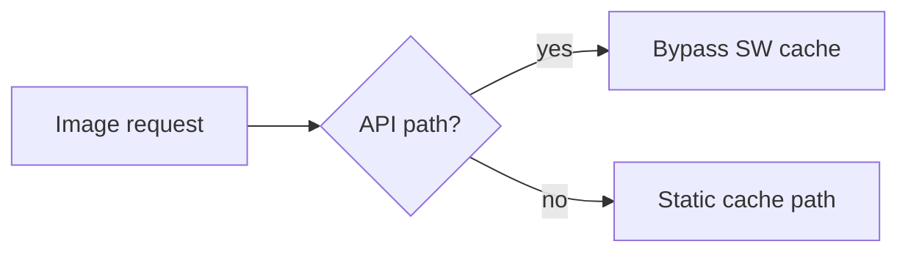

# Create PR

Open or update a well-formed GitHub PR. Select the template that matches the PR type so the description is clear and complete. Title and body are both English, written from the templates below.

## Workflow

### 1. Check for an existing PR

```bash
# Check whether the current branch already has a PR (including its state)
gh pr view --json number,title,body,url,state 2>/dev/null
```

- Existing PR, state **OPEN** → go to the **update** flow (step 1a)
- Existing PR, state **MERGED or CLOSED** → **create a new PR**; never reuse it (step 2)
- No PR → go to the **create** flow (step 2)

### 1a. Update an existing PR

When the branch already has an open PR, refresh its description from the new commits.

```bash
# Get the existing PR info
gh pr view --json number,title,body,url,commits

# Find commits added since the PR was last updated:
# read the PR's last-updated time, then list commits after it
gh pr view --json updatedAt --jq '.updatedAt'
git log --oneline --since="<updatedAt>" HEAD

# Or just list every commit the PR contains
git log --oneline main..HEAD
```

Update strategy:

1. **Read the current PR body** and understand its structure.
2. **Analyze the new commits** and what changed.
3. **Update the description incrementally:**
   - Keep the existing structure and content.
   - Add the new changes to the matching sections.
   - If a new commit changed the approach, update the "Implementation"/"Fix" section.
   - If a new commit added tests, check the matching test checklist item.
   - If a new commit touched new modules, update "Blast radius".
4. **Update the PR title** only if the scope changed materially.

```bash
# Update the PR description
gh pr edit <number> --body "$(cat <<'EOF'
<full updated PR description>
EOF
)"

# If the title also needs updating
gh pr edit <number> --title "fix: updated title"
```

`gh pr edit --body` replaces the body wholesale, so output the complete body, never a diff.

### 2. Analyze the changes (new PR)

```bash
# Current branch status
git status

# Difference from the main branch
git log --oneline main..HEAD
git diff main...HEAD --stat

# Detailed changes
git diff main...HEAD
```

- Determine the scope and blast radius.
- Identify the PR type (bug / feature / refactor / docs / chore / hotfix / perf).
- If you can't determine the type, **ask the user**.

### 3. Determine the PR type

Judge the type from the changes; ask the user to confirm when unsure.

| Type | When |
|------|------|
| `bug` | Fixing a known bug |
| `feature` | Adding a capability |
| `refactor` | Restructuring code without changing external behavior |
| `docs` | Documentation only |
| `chore` | Build, CI, dependencies, and other maintenance |
| `hotfix` | Urgent production fix |
| `perf` | Performance optimization |

### 4. Draft the PR description for the type

Write the body using the matching template below. Each template's section headers are the literal headers that must appear in the PR body.

#### Bug Fix (`bug`)

```markdown
## Problem

<!-- What the bug looks like from outside -->

## Root cause

<!-- The underlying cause -->

<!-- For flow/path/state bugs, show where it breaks with a Mermaid diagram -->
### Before

```mermaid
<!-- flowchart / sequence / state diagram tracing the failing path -->
<!-- mark the broken node with :::danger -->
```

## Fix

<!-- The approach and how it is implemented -->

### After

```mermaid
<!-- The same path once fixed; mark the fix with :::success -->
```

## Blast radius

- Modules touched:
- Breaking change: no

## Testing

- [ ] Passes locally
- [ ] Unit tests added or updated
- [ ] Reproduction verified as fixed
```

> The before/after diagram pair is the heart of a bug fix. Include it whenever flow/path/state changes; omit it for a simple one-line fix.

#### Feature (`feature`)

```markdown
## Summary

<!-- What the feature adds and which need it answers -->

## Background and motivation

<!-- Why build it? The user pain or business driver -->

## Implementation

### Design

<!-- The design at an architectural level -->

```mermaid
<!-- flowchart + subgraph for module relations / data flow / request path -->
```

### Key details

<!-- Core logic and technical detail -->

## Blast radius

- Files added:
- Files changed:
- Breaking change: no
- Database migration needed: no
- Config change needed: no

## Testing

- [ ] Passes locally
- [ ] Unit tests written for the new behaviour
- [ ] Edge cases considered
```

#### Refactor (`refactor`)

```markdown
## Goal

<!-- Why refactor? What is wrong with the code today -->

## What changed

### Before

<!-- The structure or pattern before -->

```mermaid
<!-- Diagram the module relations / call chain / data flow before -->
```

### After

<!-- The structure after, and what it improves -->

```mermaid
<!-- Diagram the structure after, against the points improved -->
```

## Behaviour parity

- External interface changed: no
- Observable behaviour changed: no
- Breaking change: no

## Testing

- [ ] Existing tests all pass
- [ ] Refactor introduces no behaviour change
```

#### Hotfix (`hotfix`)

```markdown
## Incident

<!-- What broke in production, how widely and how badly -->

**Severity:** P0 / P1 / P2
**Reach:** all users / some users / one scenario

## Root cause

<!-- The cause, as far as triage established it -->

```mermaid
<!-- Diagram the failing path; mark the fault with :::danger -->
```

## Fix

<!-- What the fix does -->

```mermaid
<!-- Diagram the path once fixed; mark it with :::success -->
```

## Risk

- Could the fix introduce new problems:
- Rollback plan needed:
- Rollback steps:

## Verification

- [ ] Reproduced locally and the fix verified
- [ ] Critical paths pass
- [ ] Reviewers notified
```

#### Performance (`perf`)

```markdown
## Bottleneck

<!-- The bottleneck as it stands -->

## Optimisation

<!-- The approach and how it is implemented -->

## Measurements

| Metric | Before | After | Gain |
|------|--------|--------|------|
| ... | ... | ... | ... |

## Blast radius

- Modules touched:
- Breaking change: no

## Testing

- [ ] Functional tests pass
- [ ] Benchmarks confirm the gain
```

#### Docs (`docs`)

```markdown
## What changed

<!-- Which docs changed, and why -->

## Details

- ...

## Related

<!-- Related feature PR or issue, if any -->
```

#### Chore (`chore`)

```markdown
## Details

<!-- What the maintenance change does -->

## Why

<!-- Why it is needed -->

## Impact

- Affects the build:
- Affects developer experience:
- Requires teammates to update their local setup:
```

### 5. Create the PR (new PR only)

Title format: `<type>: <short description>`, English, under 70 characters.

```bash
gh pr create --title "fix: correct date parsing in bill processor" --body "$(cat <<'EOF'
<PR description from the template>
EOF
)"
```

## Rules

- **Never reuse a MERGED or CLOSED PR** — create a new one.
- Title in **English**, conventional-commit format.
- Body in **English**, filled from the matching template.
- Fill the template from the actual changes; **leave no placeholder blanks**.
- Omit any template section (including diagrams) that doesn't apply.
- If the change spans types (e.g. a bug fix that also refactors), pick the primary type and note the rest in the body.
- **Before creating a PR, run `git fetch origin && git rebase origin/main`** and resolve any conflict before pushing.
- Confirm the branch is pushed to the remote before creating the PR.
- Don't guess the motivation behind a change; ask the user when unsure.

### Mermaid diagram rules

Prefer Mermaid diagrams for flow/path/state/architecture changes; omit them for a simple one-line fix.

Diagram type:

| Change | Diagram |
|---------|---------|
| Event/data flow | `graph TD` / `graph LR` |
| State machine / lifecycle | `stateDiagram-v2` |
| Multi-service / timing | `sequenceDiagram` |
| Module dependencies | `graph LR` + `subgraph` |

Authoring rules:

1. Prefer **natural-language phrases** for node labels, e.g. `API path?`, `Bypass SW cache`, `Return 404`.
2. Keep code expressions, query strings, URL params, and complex punctuation out of labels, e.g. avoid:
   - `isApiPath(url.pathname)`
   - `/api/files/:id/download?t=...`
   - text heavy with `() [] {} : ? =`
3. Put technical detail in the surrounding prose; keep only business meaning in the diagram.
4. Write decision nodes as short questions, e.g. `A{API path?}`; don't stuff code conditions into the braces.
5. Simplify labels with special characters first; quote only when truly needed, then re-validate.
6. Validate every diagram with `mermaid_validate`; complex or special-character diagrams must use `render: true`.
7. If validation or rendering is flaky, simplify the labels and retry; if still flaky, drop the diagram and explain in prose.

Preferred:



Avoid:

```mermaid
flowchart LR
    A[/api/files/:id/download?t=...] --> B{isApiPath(url.pathname)}
```

Style conventions:

- Success / normal path: `:::success` → `classDef success fill:#efe,stroke:#3c3,color:#090`
- Error / failure path: `:::danger` → `classDef danger fill:#fee,stroke:#c33,color:#900`
- Warning / degraded path: `:::warning` → `classDef warning fill:#ffe,stroke:#cc3,color:#960`
